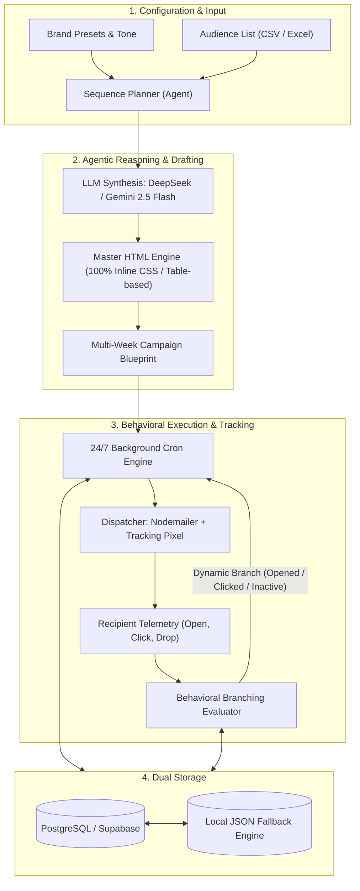

# Autonomous AI Email Marketing Agent (v2.0)

[](https://www.typescriptlang.org/)
[](https://nextjs.org/)
[](https://deepseek.com/)
[](https://ai.google.dev/)
[](https://opensource.org/licenses/MIT)

> An enterprise-grade, self-contained **Autonomous AI Marketing Agent** that designs conversion-optimized emails, plans multi-week campaign blueprints, analyzes subscriber engagement signals, and dynamically adapts follow-up sequences via behavioral branching.
>
> *Part of the **Enterprise Multi-Agent Ecosystem** engineered by Ha Minh Dung, integrating Autonomous Campaign Agents, Vector RAG Advisory, Automated Legal Document Synthesis, and Multi-Channel CRM Pipelines.*

---

## 📌 Problem & Engineering Motivation

Traditional email marketing tools (Mailchimp, Klaviyo, Brevo) require extensive manual effort:
- Marketing teams must manually write copy and test HTML templates across multiple client viewports.
- Campaign automation workflows rely on rigid, hardcoded conditional blocks that fail to personalize messaging dynamically.
- Adapting follow-up content based on user interaction (opened vs. clicked vs. ignored) requires tedious manual branching setup.

**Autonomous AI Email Agent** solves this by unifying **Agentic Sequence Planning**, **Dual LLM Synthesis (DeepSeek / Gemini 2.5 Flash)**, and **Behavioral Branching** into a continuous 24/7 background execution loop.

---

## 🏗️ System Architecture



---

## ✨ Key Technical Highlights

### 1. Agentic Multi-Week Sequence Planning
* The agent doesn't simply generate one-off emails. It generates an interconnected **multi-week campaign blueprint** (e.g., Week 1 Introduction $\rightarrow$ Week 2 Value Proposition $\rightarrow$ Week 3 Social Proof $\rightarrow$ Week 4 Urgent CTA).
* Each step retains context from preceding emails to avoid repetitive messaging.

### 2. Behavioral Branching Engine
* **Opened & Clicked:** Routes recipient to high-intent conversion follow-ups.
* **Opened but No Click:** Routes recipient to objection-handling content with alternative angles.
* **Inactive / Unopened:** Dynamically adjusts subject lines and sends gentle re-engagement prompts.

### 3. Master Email Design System
* **100% Table-based Inline HTML/CSS:** Engineered to pass rendering tests across strict email clients (Microsoft Outlook Desktop, Gmail Mobile, Apple Mail, Yahoo).
* Dynamic token replacement (`{{name}}`, `{{company}}`, `{{tracking_pixel}}`).

### 4. Zero-Dependency Local Fallback
* Out-of-the-box support for **PostgreSQL (Supabase / Vercel Postgres)**.
* Automatically activates a **file-system JSON storage engine** if no database connection is detected, allowing instant local testing without spinning up cloud infrastructure.

---

## 🚀 Getting Started

### Prerequisites
- Node.js 18.x or 20.x
- npm, pnpm, or yarn

### 1. Clone the repository
```bash
git clone https://github.com/migi0410/autonomous-ai-email-agent.git
cd autonomous-ai-email-agent
```

### 2. Install dependencies
```bash
npm install
```

### 3. Configure environment variables
Copy `.env.example` to `.env.local`:
```bash
cp .env.example .env.local
```
Fill in your API keys (DeepSeek, Gemini, or SMTP credentials).

### 4. Start the development server
```bash
npm run dev
```
Open [http://localhost:3000](http://localhost:3000) in your browser to access the live dashboard.

---

## 📂 Project Structure

```text
autonomous-ai-email-agent/
├── app/
│   ├── api/email-agent/       # Next.js App Router API endpoints
│   │   ├── campaign/          # Campaign creation & management
│   │   ├── cron/              # Background tick execution endpoint
│   │   └── generate/          # LLM drafting handler
│   ├── globals.css            # Tailwind CSS styling
│   ├── layout.tsx             # Root layout container
│   └── page.tsx               # Main Agent UI dashboard
├── modules/email-agent/
│   ├── core/                  # Core Business Logic & AI
│   │   ├── drafter.ts         # LLM synthesis (DeepSeek & Gemini Flash)
│   │   ├── sequence-planner.ts# Multi-week plan orchestrator
│   │   ├── evaluator.ts       # Behavioral tracking & branching
│   │   └── dispatcher.ts      # Nodemailer batch delivery & token replacement
│   ├── storage/
│   │   ├── agent-store.ts     # Dual database/filesystem persistence
│   │   └── schema.sql         # PostgreSQL schema definition
│   └── ui/                    # Plug-and-play UI components
│       ├── components/        # Studio, Audience, Approval & LiveMonitor steps
│       └── EmailAgentApp.tsx  # Main interactive component
└── README.md
```

---

## 👨‍💻 Author

**Ha Minh Dung (Dung Ha)**
- GitHub: [@migi0410](https://github.com/migi0410)
- LinkedIn: [linkedin.com/in/dung-ha-minh](https://www.linkedin.com/in/dung-ha-minh)
- Email: haminhdung0410@gmail.com

---

## 📄 License
This project is open-source and available under the [MIT License](LICENSE).
